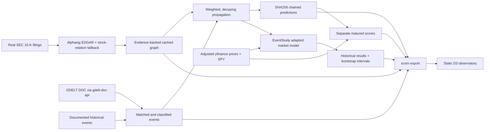

# Supply Chain Shock Map

**Live demo:** <https://supply-chain-shock-map.xingjianzhang700.workers.dev>

A research observatory connecting documented supply relationships, disruption news, and measured abnormal stock returns. Built by **Xingjian Zhang**, VP of his school's stock club.

A factory disruption can matter beyond the company in the headline. This project makes the proposed route visible, keeps its evidence attached, and checks the idea against actual market returns. Its predictions are **uncalibrated research scenarios**, not investment recommendations.

## What's new and what's reused

New work: company matching and disruption classification, bounded shock propagation, cached event-study evaluation, an append-only prediction ledger, separate outcome scoring, static exports, and the integrated interface. Existing SEC ingestion/extraction, graph construction, D3 visualization patterns, GDELT client and market-model methodology are reused as credited below. No new SEC filing parser or relationship extractor is implemented here.



## Setup and offline demo

Python 3.11 or newer; tested with the versions recorded in the validation notes. Run from the repository checkout so the CLI can locate `data/`, `vendor/`, and `ledger/` (this is a source-checkout application).

```bash
python3 -m venv .venv
source .venv/bin/activate
pip install -e '.[dev]'
python -m scsm ingest --offline
python -m scsm propagate
python -m scsm backtest
python -m scsm ledger verify
python -m scsm score
python -m scsm export
python -m http.server 8000 --directory web
```

Open <http://localhost:8000>. Serve over HTTP because browsers restrict JSON fetching from `file://`. Every visualization asset is local and every asset URL relative; the demo needs no API key and no live data request. Graph, event feed, ledger, accuracy and methodology are separate views (`web/index.html`, `web/assets/*.js`, `web/assets/styles.css`; D3 and fonts are vendored in `web/vendor/`, so the page makes no external requests).

| Shock graph (desktop) | Shock graph (390px mobile) |
|---|---|
|  |  |


Picking an event animates the shock hop by hop: color is predicted direction, muted nodes are unaffected, node size is the magnitude of the expected abnormal return, and tapping a company or edge shows its SEC evidence sentence and filing. The ledger view recomputes every hash with Web Crypto and compares the head with the Python verifier's exported head; "Simulate tampering" edits an in-memory copy to show the chain breaking. The accuracy charts read `results.json` directly, so they always show the latest backtest numbers. Animations respect `prefers-reduced-motion`.

`python -m scsm --help` documents all commands. `propagate --event ID` selects an event; `ledger append --event ID` appends it once. Default `ledger append` appends all cached events with predictions. **Historical events appended now are labeled historical replays and excluded from prospective scores.** Do not interpret them as past forecasts.

For live ingestion run `python -m scsm ingest`. For missing price retrieval use `python -m scsm backtest --online` or `python -m scsm score --online`. Network failures and incomplete future windows never become fabricated observations. Keep event and price caches in version control for reproducibility. Source acquisition details and SEC graph rebuild instructions are in [graph provenance](docs/graph-provenance.md); `scripts/fetch_data.py` documents historical event and price acquisition.

## Graph coverage and assumptions

Only a real subset is shipped: **12 nodes and 10 reviewed edges from 14 primary 2021 SEC filings**. SEC-derived relationships, evidence sentences, filing URLs, dates and source hashes are preserved in `data/graph.json` and `data/sec/`. The provenance report explains the inclusion review and rejected keyword candidates. Filings are historical snapshots, not a complete or current map of the S&P 500. The graph intentionally excludes ambiguous matches and unverified relationships.

A disruption at a supplier travels downstream to its customers (lost supply); a disruption at a customer travels upstream to its suppliers (lost demand). A path never changes direction, so a shock cannot zig-zag into an unrelated sibling supplier. Base issuer shock is signed severity × 5 percentage points; each hop multiplies the prior magnitude by edge weight × 0.5, up to three hops. Missing measured exposures use an explicitly labeled heuristic weight. Extraction confidence is not a financial exposure measurement. The strongest simple path per ticker is retained, rather than summing overlapping paths. Cycles cannot amplify shocks. Filings dated after an event are excluded from its scenario. Competitor substitution is supported only for explicitly labeled competitor inputs; no competitor or supplier links are invented from shared sectors.

Severity, decay and magnitude are modeling choices, not estimated returns. Expected abnormal return percentages are signed and use the same scenario scale at each study horizon; no horizon calibration is claimed. Entity matching uses the cached real S&P 500 constituent list and aliases. Short and ambiguous names are handled conservatively; headline matching and keyword classification still make mistakes. News publication dates can differ from the underlying disruption date.

## Results and findings

Executed on the checked-in adjusted-price caches with `python -m scsm backtest`: **62 real historical events** (strikes, recalls, export/import bans, plant shutdowns, cyberattacks and IT outages, supplier quality escapes, 2021-03 to 2025-10), **106 ticker predictions per horizon**: 66 direct issuer, 5 downstream, 35 upstream. Propagated predictions come from 19 of the 62 events; no observation was excluded. Every event in `data/events/historical.json` links a source (SEC filing, company or regulator release, or major news) that was fetched and found to contain the quoted text confirming the event and its date.

MAE is in percentage points of CAR. CIs are percentile intervals from 10,000 event-cluster bootstrap resamples (seed 2026). p is an exact two-sided binomial test of the hit rate against 50%. "Model − zero" is model MAE minus the MAE of always predicting 0; negative means the model beat zero.

| Horizon | Group | n (events) | Hit rate [95% CI] | p vs 50% | Model MAE | Zero MAE | Model − zero [95% CI] |
|---|---|---:|---|---:|---:|---:|---|
| +1 | All | 106 (62) | 62% [52%, 72%] | 0.015 | 2.45 | 1.79 | +0.66 [+0.27, +1.04] |
| +1 | Direct issuer | 66 (62) | 73% [62%, 83%] | <0.001 | 3.18 | 2.29 | +0.89 [+0.29, +1.46] |
| +1 | Downstream (lost supply) | 5 (5) | 20% [0%, 60%] | 0.375 | 2.66 | 2.21 | +0.45 [−0.30, +0.90] |
| +1 | Upstream (lost demand) | 35 (17) | 49% [29%, 66%] | 1.000 | 1.04 | 0.80 | +0.25 [+0.01, +0.49] |
| +5 | All | 106 (62) | 54% [43%, 65%] | 0.497 | 3.28 | 2.89 | +0.39 [−0.12, +0.89] |
| +5 | Direct issuer | 66 (62) | 55% [42%, 67%] | 0.539 | 3.98 | 3.43 | +0.55 [−0.23, +1.31] |
| +5 | Downstream (lost supply) | 5 (5) | 20% [0%, 60%] | 0.375 | 4.11 | 3.56 | +0.55 [−0.10, +0.95] |
| +5 | Upstream (lost demand) | 35 (17) | 57% [37%, 81%] | 0.500 | 1.84 | 1.79 | +0.05 [−0.32, +0.36] |
| +20 | All | 106 (62) | 63% [53%, 73%] | 0.008 | 5.63 | 5.93 | −0.30 [−0.79, +0.20] |
| +20 | Direct issuer | 66 (62) | 68% [56%, 79%] | 0.004 | 5.82 | 6.28 | −0.46 [−1.19, +0.30] |
| +20 | Downstream (lost supply) | 5 (5) | 20% [0%, 60%] | 0.375 | 9.08 | 8.53 | +0.55 [−0.10, +0.95] |
| +20 | Upstream (lost demand) | 35 (17) | 60% [43%, 79%] | 0.311 | 4.77 | 4.90 | −0.13 [−0.44, +0.16] |

What this says, and does not:

- **Direction of the directly hit company is informative; size is not.** Direct-issuer signs were right 73% of the time at +1 day and 68% at +20 days. But at +1 day the model's MAE is *worse* than predicting zero (CI excludes 0): the fixed 5% × severity scenario overstates typical next-day moves.
- **Supply-chain propagation is not validated.** Upstream (lost-demand) predictions are coin-flip accurate at +1 day and statistically indistinguishable from 50% and from zero error at every horizon. Only 5 downstream (lost-supply) observations exist; 1 of 5 had the right sign.
- **No horizon shows the model beating zero on error with a CI that excludes 0.** The +20 day overall difference (−0.30 pp) has a CI spanning zero.
- p-values assume independent predictions. Several predictions share an event, so they overstate evidence; the cluster bootstrap CIs are the more honest interval. Twelve comparisons are reported without multiple-testing correction.

Caveats: the event list is a hand-selected convenience sample, not every shock in the period, and it leans toward large, well-reported disruptions. Several events overlap in time (e.g. Boeing 2023–2024 quality issues, Tesla factory halts), so windows are not independent. Event severities and edge weights are uncalibrated assumptions. The SEC graph is small (12 companies, 10 edges from 2021 10-Ks) and may be stale for 2024–2025 events. Sector peers and entity matching use the current S&P 500 list, not point-in-time membership, which adds survivorship bias. Dates are day-level; intraday disclosures lose their same-day reaction, while weekend and holiday disclosures anchor to the prior session so the first trading reaction is captured. Yahoo adjusted prices can be revised. Correlation and same-sector-control metrics remain in `data/results.json` and the Accuracy tab.

Live GDELT acquisition was attempted and the request status is cached in `data/events/gdelt-*.json`; when rate-limited it contributes **no invented events**. The initial ledger is timestamped at this build and contains real historical-event replay scenarios. There are no matured prospective scores yet. Prospective performance is unavailable, not 0%.


The historical cohort is deliberately small and curated. It cannot establish a tradable edge. See `data/results.json` for individual event/ticker/horizon observations, model fit, exclusions and uncertainty intervals. Numerical claims must be read alongside sample size and the following limits.

The event study adapts EventStudy's OLS market model: fit stock return = alpha + beta × SPY return on trading days -250..-11. CAR is the sum of residuals on +1 through +1/+5/+20, excluding day 0. Day 0 is the last shared trading session on or before the disclosure date, so a weekend or holiday disclosure is first measured on the next session. Adjusted daily close data are used; publication time and after-hours effects are not modeled. Full horizons must exist, and insufficient estimation histories are excluded. Event overlap, selection bias, current constituent survivorship, stale graph coverage and uncalibrated severities limit interpretation. Bootstrap intervals describe resampling uncertainty within this cohort, not a guarantee of future performance.

The zero-return baseline is deployable as a no-effect forecast. The same-sector average uses contemporaneous realized peer CARs and is labeled an **ex-post control**, not an available-at-prediction forecast. Missing peer observations must be reported rather than treated as zero. Historical replay accuracy and prospective ledger accuracy are distinct throughout the interface.

## Ledger and daily operation

`ledger/predictions.jsonl` is append-only. Each entry has UTC issuance time, original event, predictions/paths, previous hash and SHA256 hash. The hash input is RFC 8785 canonical UTF-8 JSON of the full entry excluding `hash`; genesis is 64 zeroes. `python -m scsm ledger verify` checks the chain, and the browser independently recomputes it using Web Crypto. Retain a trusted head hash (or independently archived Git commit) to detect a complete rewrite: a hash chain alone does not prove independent timestamps or prevent rewriting the entire history.

`ledger/scores.jsonl` is separate and deduplicated by prediction hash/ticker/horizon. Historical replays never enter prospective scoring. For prospective entries, scoring anchors conservatively to a session after issuance and only appends a horizon once its complete window has closed; it never modifies predictions. Empty scores mean no matured prospective observations, not zero accuracy.

[Daily automation](.github/workflows/ledger.yml) runs ingestion, append, scoring and export, then commits the changed caches/ledger/assets. GitHub Actions must be enabled and its token permitted to write repository contents. A fresh ingest can return no new observations because of rate limits or unmatched news; consult its cached status. Changes are serialized with workflow concurrency and local ledger file locks.

[CI](.github/workflows/ci.yml) runs Ruff, offline pytest, chain verification and a byte-level rebuild check of committed `web/data`. To validate locally:

```bash
ruff check .
pytest -q
python -m scsm ledger verify
python -m scsm export
git diff --exit-code -- web/data
```

## Static Cloudflare Worker assets

`wrangler.jsonc` configures the `web/` asset directory and `worker/index.js` serves the asset binding. No server-side API or scheduled handler is needed; cron belongs to GitHub Actions. The live demo is deployed from this configuration to supply-chain-shock-map.xingjianzhang700.workers.dev.

## Credits and licenses

All five supplied source LICENSE files were read and verified as MIT. Exact texts are retained in [THIRD_PARTY_LICENSES](THIRD_PARTY_LICENSES/) and upstream notices are retained alongside vendored code. [NOTICE](NOTICE) records provenance and modifications; [graph provenance](docs/graph-provenance.md) records source commits and extraction evidence.

| Repository | License | Copyright holder | Exactly what was taken |
|---|---|---|---|
| [sushaan-k/alphasig](https://github.com/sushaan-k/alphasig) | MIT | 2026 Sushaan Kandukoori | Vendored source including EDGAR ingestion, supply-chain engine, models and NetworkX graph; EDGAR download/parsing and graph construction used; LLM extraction engine retained but not run without credentials |
| [aaryapatel09/sigint](https://github.com/aaryapatel09/sigint) | MIT | 2026 Sushaan Kandukoori | Predecessor attribution and license only; no separate duplicate implementation |
| [supat-roong/stock-relation](https://github.com/supat-roong/stock-relation) | MIT | 2026 Supat Roongpraiwan | SEC supply-chain ingestion deterministic fallback and D3 frontend source/patterns adapted for local static data, event animation and responsive views |
| [alex9smith/gdelt-doc-api](https://github.com/alex9smith/gdelt-doc-api) | MIT | 2020 Alex Whitehead-Smith | GDELT DOC 2.0 client/filter implementation, vendored for actual queries |
| [zrxbeijing/EventStudy](https://github.com/zrxbeijing/EventStudy) | MIT | 2020 Rongxin | Market-model alpha/beta estimation and abnormal-return methodology adapted; reference implementation preserved |

D3 and any additional redistributed libraries have their own notices alongside their assets and in the third-party license directory. SEC filings, news metadata and market data are source material with their own terms; the code's MIT license does not relicense third-party data. `Seungukeeee/bottleneck_indicators` has no license: ideas/citation only; **zero code copied**.

Original project code: MIT, Copyright (c) 2026 Xingjian Zhang. **Not financial advice.**
