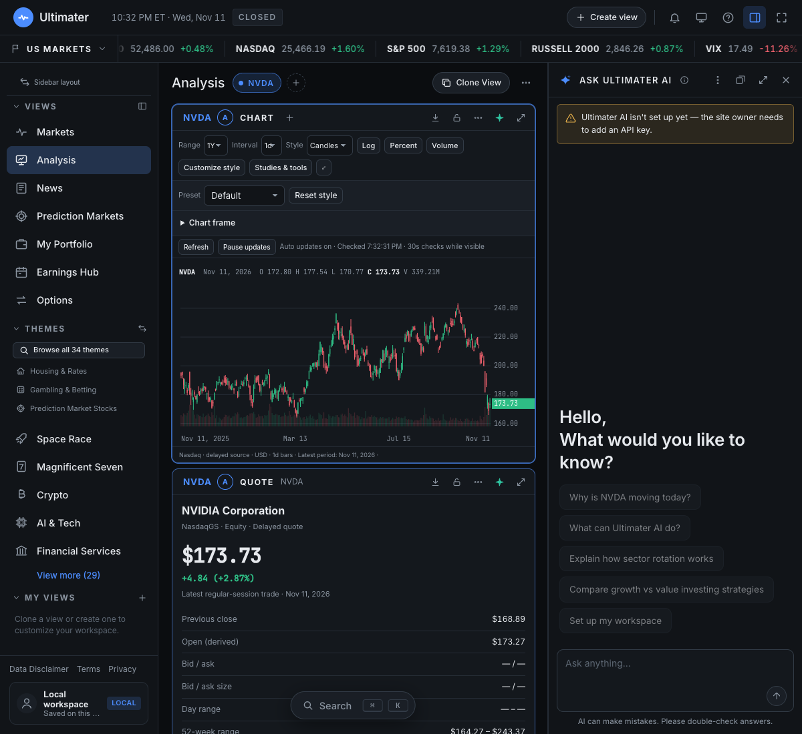

# Ultimater

**Supply-chain research, watchlists, and a dedicated stock analyzer.**

Ultimater builds on the original Supply Chain Shock Map project. The research dashboard keeps its Briefing, Watchlist, Portfolio, Calendar, and demonstration Ledger. The Python research engine, source evidence, historical data, and append-only research ledger remain separate from that demonstration UI.

**Analyzer** is the additional workspace informed by the AlphaSpace interface audit. It brings charts, company financials, earnings, news, options, and thematic research into linked panels. Open it from the dashboard's **Analyzer** link; use **Research dashboard** in its sidebar to return.

Built by **Xingjian Zhang** with vanilla JavaScript, a Cloudflare Worker, and a Python research engine.



## What you can do

| Workspace | Features |
| --- | --- |
| **Research dashboard** | Original watchlist, headline impact scenarios, company context, portfolio, calendar, and demonstration ledger. The research engine and its append-only ledger remain available through the Python tools below. |
| **Markets & themes** | Movers, watchlists, heatmaps, screens, and 34 stock themes, including housing, gambling, semiconductors, nuclear energy, and prediction-market exposure. |
| **Stock analysis** | Candlesticks and other chart styles, 52 studies, drawing tools, comparisons, replay, company profiles, financial statements, rolling LTM, YoY rows, and analyst consensus. |
| **Earnings** | Calendar navigation, company details, reported results and estimates, and shareable earnings images. |
| **News** | Ticker and theme feeds, 26 topic filters over loaded headlines, article reading, and share links. |
| **Options** | Chains, contract details, configurable columns, and derived IV/Greeks and other statistics. Optional Alpaca indicative data and a separate subscription-based transaction-flow adapter. |
| **Prediction markets** | Stock-relevant Polymarket events across company, AI, macro, trade, healthcare, energy, and geopolitical categories. Topic filters, activity ranking, percentage odds, rules, and pagination. Sports and unrelated questions are screened out. Browsing only; no order submission. |
| **Portfolio** | Manual and CSV holdings, sortable tables, allocation, movers, recorded account history, privacy masking, and an optional read-only broker connection. |
| **AI assistant** | A bottom-right **Ask AI** button, panel context, research questions, workspace actions, and daily recaps. Requires your own Anthropic API key. |

Custom views support movable, resizable panels and linked ticker groups. Layouts and preferences persist in your browser. Workspace export/import and optional encrypted layout sync are available. Phone layouts stack panels and use a navigation drawer.

## Run locally

Requires **Node.js 22+** and npm. Python 3 is needed for the credential setup helpers; Python 3.11+ is needed only if you run the research engine.

```sh
git clone https://github.com/zandy700/supply-chain-shock-map.git
cd supply-chain-shock-map
npm ci
npm run dev -- --port 8820
```

Open the **[research dashboard](http://127.0.0.1:8820/#/briefing)** or the **[Analyzer](http://127.0.0.1:8820/space?view=analysis)**.

The workspace can start without provider keys. Public endpoints supply available data; features that need credentials show their setup or unavailable state. Use the Worker server above for the workspace APIs. A plain static file server does not provide them.

<details>
<summary>Run the research dashboard in sample-only mode without the Worker</summary>

```sh
python3 -m http.server 8000 --directory web
```

Open `http://localhost:8000/?seed=demo#/briefing`. This mode uses the isolated `web/seed/` demonstration data. It does not activate the workspace's server APIs or read the research ledger.

</details>

## Connect optional providers

Credentials belong in the ignored **`.dev.vars`** file for local development. Restart the Worker after changing them. Each fresh clone needs its own credentials; none are included in this repository.

| Provider | Configuration | Enables |
| --- | --- | --- |
| **Alpaca** | `npm run alpaca:setup` | Privately prompts for `ALPACA_API_KEY` and `ALPACA_API_SECRET`; enables indicative options snapshots. |
| **Finnhub** | `FINNHUB_API_KEY` | Additional news, quote, financial, and analyst coverage, subject to your plan. |
| **Anthropic** | `ANTHROPIC_API_KEY`; optional `PULSE_AI_MODEL` | Ultimater AI and AI recaps. API usage may incur charges. |
| **Unusual Whales** | `UNUSUAL_WHALES_API_KEY` | Transaction Flow, with an eligible provider subscription. |
| **SnapTrade** | `npm run broker:setup` | Read-only brokerage connection, subject to provider app approval and configuration. Manual/CSV portfolios work independently. |

For example, optional local settings can be added to `.dev.vars`:

```dotenv
FINNHUB_API_KEY="your_finnhub_key"
ANTHROPIC_API_KEY="your_anthropic_key"
```

The Alpaca helper preserves other settings and hides both credential prompts. Check `http://127.0.0.1:8820/api/space/options/status` after restarting. A configured status means keys are present; verify the chain's actual `provider`, `feed`, notices, and coverage to confirm successful access.

See [Alpaca setup](docs/alpaca-options.md), [broker setup](docs/broker-setup.md), and [prediction-market API coverage](docs/prediction-markets.md).

## Understand the data

- **Refreshes are polling, not a streaming entitlement.** Visible stock charts check every 30 seconds and crypto charts every 15 seconds. Hidden/offscreen panels pause updates. Provider delays still apply; a new check does not guarantee a new candle.
- **Sources stay visible.** Nasdaq stock/options data may be delayed. Crypto uses Coinbase snapshots. ETF samples, Treasury yields, currency rates, sampled candles, and derived statistics are labeled. Missing values stay unavailable.
- **Alpaca's configured feed is indicative.** Quotes are modified rather than executable OPRA quotations; trades are delayed. Large chains can be partial because requests stop after five pages. This integration supplies options data; it does not switch every stock chart to Alpaca.
- **Catalog coverage is paginated.** Polymarket event search queries the provider and supports result pagination; secondary prediction-market filters and news filters operate on loaded results. The prediction-market page is a public catalog, not anyone's private bets or positions.
- **Portfolio history must be recorded.** Current holdings cannot reconstruct past deposits, withdrawals, trades, or investment returns. Local price alerts run while the page is open.
- **Some data requires additional sources.** Proprietary fair values, analyst accuracy scores, some asset classes, and premium transaction feeds are not supplied merely by rendering their controls.

Ultimater is an independent implementation informed by a reference-interface audit. It is not affiliated with Yahoo, and it does not use Yahoo account cookies or private portfolio endpoints. Code licensing does not grant rights to redistribute provider data. Review provider terms before offering a public multi-user service.

**For research and education; not financial advice.** AI responses, provider data, derived statistics, and historical research can be incomplete or wrong.

## Project structure

```text
web/space/       Workspace shell, charts, panels, themes, and AI interface
worker/space/    Market-data adapters, workspace APIs, AI, and tests
web/            Earlier Briefing UI, portfolio helpers, and static assets
worker/         Worker entry point, broker connection, and shared APIs
scsm/           Python supply-chain research and ledger tooling
data/           Research inputs, provenance, and cached results
ledger/         Append-only predictions and separate outcome scores
docs/           Setup guides, methodology, screenshots, and audit reports
```

The frontend uses native ES modules; there is no frontend compilation step. Cloudflare serves static assets and runs the API handlers. Durable Objects support broker sessions and encrypted workspace sync. Existing `watchlist-pulse` storage and package names remain for compatibility.

## Development and checks

```sh
npm test
npx wrangler deploy --dry-run --outdir /tmp/ultimater-build
```

JavaScript tests cover adapters, validation, source/fallback behavior, calculations, refresh scheduling, portfolios, AI tool boundaries, and workspace import/export. Provider responses are stubbed where appropriate; passing tests does not establish a paid subscription or production activation.

For the separate research engine:

```sh
python3 -m venv .venv
source .venv/bin/activate
pip install -e '.[dev]'
ruff check .
pytest -q
python -m scsm ledger verify
```

Read the [research methodology and historical findings](docs/research-engine.md) before interpreting its results. The historical replay does not validate a tradable forecasting edge.

## Deployment

`wrangler.jsonc` contains the Worker, static assets, and Durable Object migrations. To deploy your own instance, choose your Worker name, authenticate with Cloudflare, and configure the required provider secrets with `npx wrangler secret put SECRET_NAME` before running `npx wrangler deploy`. Broker callbacks require separate hosted setup.

Local `.dev.vars` credentials are not automatically uploaded as hosted secrets. A GitHub push alone does not activate providers or deploy this app.

## Documentation and credits

- [Original dashboard and research preservation check](docs/original-workspace.md)
- [Analyzer features, refresh behavior, and limitations](docs/space.md)
- [Reference audit: changes, evidence, and remaining gaps](docs/rea-full-audit.md)
- [Supply-chain research methodology and full attribution](docs/research-engine.md)
- [Graph provenance](docs/graph-provenance.md)
- [Third-party notices](NOTICE) and [license texts](THIRD_PARTY_LICENSES/)

Original project code is licensed under the [MIT License](LICENSE), copyright © 2026 Xingjian Zhang. Adapted and vendored research components retain their upstream attribution and licenses; see the full credits above.
