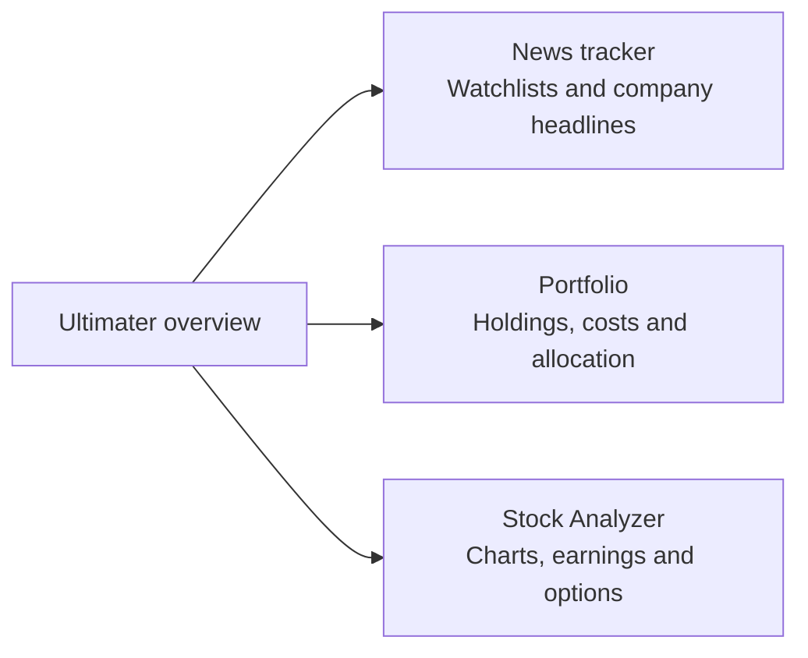
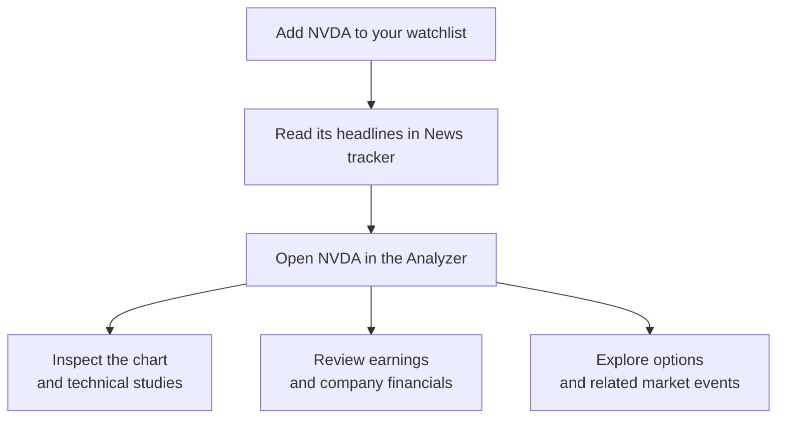
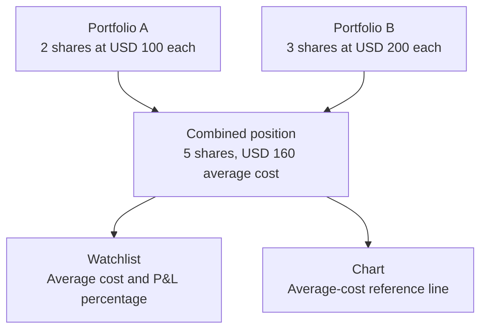

# Ultimater

**Track company news, manage your portfolio, and research stocks in one workspace.**

Ultimater connects a news-tracking dashboard, a portfolio manager, and a customizable stock Analyzer. Follow companies, read developments that could affect them, review your holdings and purchase costs, and investigate charts, earnings, options, and stock-relevant prediction markets.

**[Open Ultimater](https://supply-chain-shock-map.xingjianzhang700.workers.dev/#/home)** — choose **News tracker**, **Portfolio**, or **Stock Analyzer** from the overview.

## Table of contents

- [What Ultimater does](#what-ultimater-does)
- [Demo walkthroughs](#demo-walkthroughs)
- [Functions at a glance](#functions-at-a-glance)
- [Data, refresh, and privacy](#data-refresh-and-privacy)
- [Original research engine](#original-research-engine)
- [For developers](#for-developers)
- [Documentation and credits](#documentation-and-credits)
- [Download and run locally](#download-and-run-locally)

## What Ultimater does

Three connected workspaces help you move from a headline to a closer look at a company and your own holdings.



- **News tracker:** follow up to **40 stocks**, read company headlines and keyword-based impact scenarios, and check upcoming company and market events.
- **Portfolio:** enter holdings or import a CSV, record purchase costs and account history, and review allocation and price changes. Optional broker linking supplies supported holdings through a read-only connection.
- **Stock Analyzer:** investigate a company in linked panels with charts, financials, analyst estimates, news, earnings, and options. Explore market movers, thematic screens, and stock-relevant Polymarket and Kalshi events.

The dashboard and Analyzer share the same device-local watchlist. Their navigation, display preferences, and portfolio purchase-cost overlays work together.

## Demo walkthroughs

### Follow a company from news to research

Example workflow using **NVDA**. This illustrates how to use the app; it is not a live market signal.



Ticker groups let linked panels follow the same company. You can lock a panel to another ticker, add comparisons, or rearrange the workspace to suit your research.


### See purchase costs across portfolios

Record a stock in more than one supported portfolio and Ultimater combines its known purchase costs using share weights.



These numbers are illustrative. Unknown costs are excluded from cost-based calculations, partial coverage is marked, and privacy mode masks position values. Current holdings do not reconstruct historical investment returns.

### Explore stock-relevant prediction events

Search for a company or topic such as **Jensen Huang**, **Fed rates**, or **tariffs**. Inspect the event's individual contracts, displayed odds or prices, deadline, and resolution rules before opening its source.

Polymarket supplies company and broader market questions. Kalshi adds complementary macro, employment, housing, and other stock-relevant coverage; recognized overlaps are hidden with Polymarket taking priority. Sports and unrelated questions are screened out. The catalog is for research and browsing; the app does not submit bets or orders.

## Functions at a glance

| Area | What you can do | Access and limits |
| --- | --- | --- |
| **News tracker and watchlist** | Save up to 40 stocks; read company headlines, keyword scenarios, company context, and a daily briefing. Changes sync across panels and browser tabs. | Finnhub powers the tracker’s live news and lookup. Sample mode has a separate watchlist. Scenarios are heuristics, not verified forecasts. |
| **Portfolio** | Enter or import CSV holdings, track shares and average purchase cost, sort holdings, review allocation and movers, and record account-value history. | Manual portfolios need no API key. Broker linking is optional and depends on SnapTrade configuration and provider access. |
| **Charts and company research** | Use candlesticks and other chart styles, technical studies, drawing tools, comparisons, replay, financial statements, rolling LTM/YoY views, and analyst consensus. | Available coverage depends on the connected sources. Missing data stays unavailable. |
| **Markets and themes** | Browse movers, heatmaps, screens, and 34 stock themes, including housing, gambling, AI, semiconductors, and nuclear energy. | Source coverage, sampling, and delays are labeled. |
| **Earnings and calendar** | Navigate earnings dates, inspect company results and estimates, review related events, and create shareable earnings images. | Dates and estimates depend on source availability and can change. |
| **Options** | Inspect chains and contract details, configure columns, and review derived IV/Greeks, payoff views, and volume/OI scans where inputs exist. | Alpaca indicative data is optional. Individual transaction flow requires a separate eligible Unusual Whales API subscription. |
| **Prediction markets** | Search and filter stock-relevant Polymarket/Kalshi events, inspect contracts and rules, sort activity, and browse more results. | Public catalog coverage is bounded and paginated. The saved-event mode reads periodically refreshed snapshots. |
| **Ultimater AI** | Open **Ask AI** at the bottom right, attach panel context, ask research questions, use workspace actions, and request recaps. | Requires an Anthropic API key. API charges may apply; private holdings are excluded when privacy mode is enabled. |
| **Workspace and alerts** | Move/resize panels, link ticker groups, save custom views, change theme/density, import/export layouts, and create local price alerts. | Browser storage keeps local preferences. Alerts check while the page is open; optional encrypted layout sync needs server support. |

## Data, refresh, and privacy

- **A refresh is a check, not a guarantee of a new price.** Visible stock charts check every 30 seconds and crypto charts every 15 seconds. Hidden/offscreen panels pause. Provider delays and market hours still apply.
- **Sources and missing values stay visible.** Nasdaq data can be delayed; crypto uses Coinbase snapshots. Sampled data, ETF proxies, and derived statistics are labeled. Rendering a control does not establish access to its data.
- **Alpaca indicative has specific limits.** Quotes are modified rather than executable OPRA quotations, trades are delayed, and session volume/open interest are unavailable. Large chains can have partial snapshot coverage. This integration does not move every stock chart onto Alpaca.
- **Prediction events have finite coverage.** Search and discovery are paginated. Loaded-result filters do not search an entire exchange. GitHub snapshots are scheduled every 15 minutes and can be delayed; saved timestamps and stale states remain visible.
- **Holdings and keys have separate storage.** Watchlists, manual portfolios, and preferences stay in the browser. The complete local app stores API keys in its ignored private configuration, never browser storage or a public release. Browser origins differ between the hosted site, local ports, and computers.
- **Costs and history have boundaries.** Supported USD holdings contribute to combined purchase-cost overlays. Unknown costs and unsupported positions are not invented. Portfolio history requires recorded values; current shares do not reveal past trades, cash flows, or returns.

**For research and education; not financial advice.** Provider data, AI responses, derived figures, and historical research can be incomplete or wrong. Ultimater is independent of Yahoo and does not use Yahoo account cookies or private portfolios. Provider data rights remain separate from the code license.

## Original research engine

Ultimater builds on **Supply Chain Shock Map**. The original Python research engine, source evidence, supply-chain graph, historical datasets, and append-only prediction ledger remain in the repository alongside the app.

The research engine studies news-driven supply-chain shocks and records evidence-linked predictions and outcomes. The dashboard’s seeded demonstration ledger is separate from the research ledger. Historical replay results do not establish a tradable forecasting edge.

Read the [research methodology, findings, and attribution](docs/research-engine.md) and the [original-workspace preservation check](docs/original-workspace.md).

## For developers

The frontend uses native JavaScript modules. A Cloudflare Worker supplies app APIs, with Durable Objects for broker sessions and encrypted layout sync. The local launcher runs that Worker on your own computer.

<details>
<summary>Project structure and checks</summary>

```text
web/                  Dashboard, portfolio, overview, and API setup
web/space/            Analyzer shell, charts, panels, themes, and AI
web/shared/           Navigation, watchlist, and purchase-cost helpers
worker/               App APIs, broker connection, and tests
worker/space/         Market-data adapters and Analyzer APIs
scripts/              Local launcher, release packaging, and public event sync
scsm/                 Python research engine and ledger tools
data/ and ledger/     Research inputs, provenance, predictions, and outcomes
```

With dependencies installed, run these commands in the repository terminal:

```sh
npm test
npm run app:build
npx wrangler deploy --dry-run --outdir /tmp/ultimater-build
```

The release workflow also checks a fresh local install, credential save/remove restarts, and shutdown on Windows and Linux. Provider responses are stubbed where appropriate in unit tests; passing checks do not establish provider subscriptions or production approval.

For research-engine development, the checks are `ruff check .`, `pytest -q`, and `python -m scsm ledger verify`. See the [research guide](docs/research-engine.md) for its environment and workflows.

</details>

## Documentation and credits

- [Analyzer features, refresh behavior, and limitations](docs/space.md)
- [Reference-interface audit and remaining gaps](docs/rea-full-audit.md)
- [Supply-chain research methodology and full attribution](docs/research-engine.md)
- [Graph provenance](docs/graph-provenance.md)
- [Third-party notices](NOTICE) and [license texts](THIRD_PARTY_LICENSES/)

Built by **Xingjian Zhang**. Original project code is licensed under the [MIT License](LICENSE), copyright © 2026 Xingjian Zhang. Adapted and vendored research components retain their upstream licenses and attribution.

## Download and run locally

### Complete local app

**[Download ultimater-local-app.zip from GitHub](https://github.com/zandy700/supply-chain-shock-map/releases/latest/download/ultimater-local-app.zip)**. It includes the news tracker, manual/CSV portfolio, Analyzer, prediction events, and in-app API setup.

1. Install **Node.js 22 or newer**, then download and unzip the app.
2. Open Terminal in the extracted `ultimater-local-app` folder and run:

   ```sh
   npm start
   ```

3. Open the local address printed in Terminal, normally **[127.0.0.1:8820](http://127.0.0.1:8820/#/home)**. Keep the terminal open while using the app.

First launch installs locked dependencies and needs internet access. Live feeds also need internet. Manual portfolios and available public data work without provider keys; some features require your own provider access. No Cloudflare account or hosted deployment is needed to run locally.

See the [full local app guide](docs/local-app.md) for ports, privacy, backup, and troubleshooting.

### API setup inside the app

Open **[Setup & download](http://127.0.0.1:8820/setup)** in the local app. Follow its provider instructions, enter your own keys, and save. The local server restarts automatically. Finnhub, Alpaca, and flow access can be checked from the same screen.

| Provider | Enables | Local configuration fields |
| --- | --- | --- |
| **Finnhub** | Live tracker news, company lookup, and additional quote/financial coverage | `FINNHUB_API_KEY` |
| **Alpaca** | Indicative options-chain snapshots | `ALPACA_API_KEY`, `ALPACA_API_SECRET` |
| **Anthropic** | Ultimater AI and recaps; API billing applies separately from a chat subscription | `ANTHROPIC_API_KEY`; optional `PULSE_AI_MODEL` |
| **Unusual Whales** | Individual options transactions, with eligible API access | `UNUSUAL_WHALES_API_KEY` |
| **SnapTrade** | Optional read-only broker linking, subject to OAuth app setup and access | `SNAPTRADE_OAUTH_CLIENT_ID`, `SNAPTRADE_OAUTH_CLIENT_SECRET` |

Keys are saved only to the local installation’s ignored **`.dev.vars`** file. Each download or clone needs its own credentials. A saved-key status reports configuration, not successful provider access. The setup screen does not issue a paid AI request; sending an AI message verifies that access.

The [hosted setup page](https://supply-chain-shock-map.xingjianzhang700.workers.dev/setup) is read-only and does not accept visitors’ API keys. People deploying their own Worker must configure private server secrets separately; local keys are not uploaded automatically.

See [Alpaca setup](docs/alpaca-options.md), [broker setup](docs/broker-setup.md), and [prediction-market API coverage](docs/prediction-markets.md).

<details>
<summary>Run from source or use the smaller event-only pack</summary>

To run the full repository, use your terminal:

```sh
git clone https://github.com/zandy700/supply-chain-shock-map.git
cd supply-chain-shock-map
npm start
```

The separate **[ultimater-local-pack](https://github.com/zandy700/supply-chain-shock-map/actions/workflows/prediction-events.yml)** is a smaller saved-event board with no installed dependencies or provider keys. It follows public GitHub snapshots while visible; it does not supply the full app APIs or editable API setup. See the [event-only guide](docs/local-event-pack.md).

From a checkout, build that smaller pack with `npm run pack:build` and launch it with `npm run pack:start`. Refreshing public event snapshots uses `npm run events:sync`.

For advanced development, `npm run dev -- --port 8820` starts the Worker directly; in-app key entry requires the complete `npm start` launcher. The existing `npm run alpaca:setup` and `npm run broker:setup` terminal helpers remain available. Restart a directly launched Worker after editing `.dev.vars`.

To deploy a hosted copy, configure your Worker name and private secrets in Cloudflare, then use `npx wrangler deploy`. Broker callbacks require their own hosted setup. A GitHub push alone does not deploy the app or activate providers.

</details>
